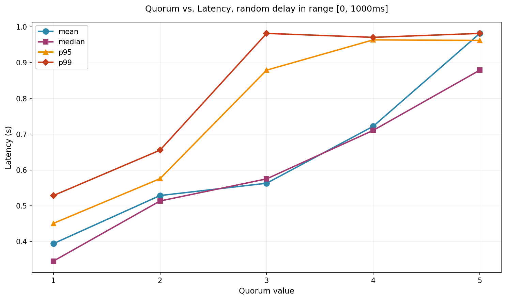
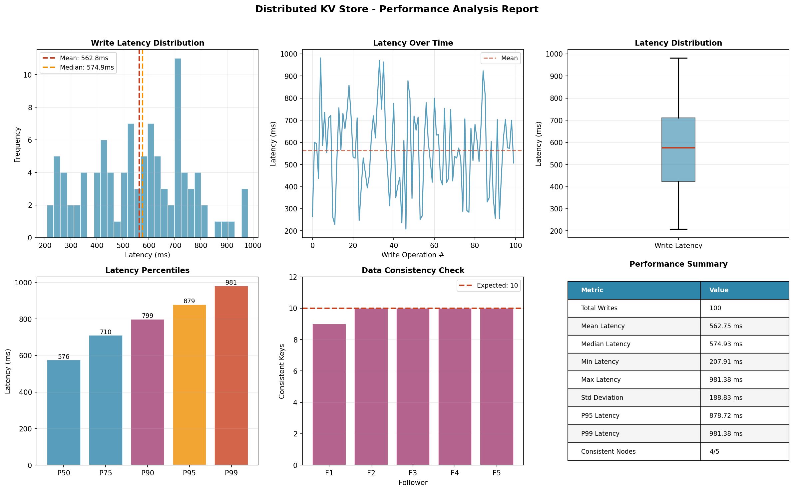

# Distributed Key–Value Store with Leader-Based Replication

### Network Programming — Laboratory Work  
### Group: FAF-233  
### Author: Amza Vladislav

---


## Introduction

This laboratory work explores the construction of a **distributed key-value database** that relies on a **single-leader replication model**. All write operations are routed through the leader, which propagates state updates to follower nodes via **semi-synchronous replication**.  

The project demonstrates core distributed system themes:

- replication  
- concurrency  
- fault tolerance  
- network delays  
- quorum behaviour  
- consistency vs availability trade-offs  

### Main Capabilities
- One dedicated **leader** and five replica **followers**
- **Quorum-based write confirmation** (default: 3/5 followers)
- **Simulated network delays** (0–1000 ms)
- **Asynchronous FastAPI** server
- **Automatic performance tests** with graph generation  

### Technology Stack
- FastAPI, Uvicorn  
- Python asyncio  
- httpx (async HTTP)
- Docker Compose  
- Matplotlib  

---

## Fundamental Ideas

### Latency
Latency refers to the time required for a request to complete. In this system, latency is affected by:

- follower replication delay  
- leader compute time  
- simulated network latency  

### Quorums
A quorum is the **minimum number of replicas** required to acknowledge a write before it is considered durable.

| Quorum | Properties |
|--------|-----------|
| 1 | fastest, unsafe |
| 3 | balanced, durable |
| 5 | slowest, strongest |

### Leader Replication
- All writes flow through the leader  
- Followers accept replicated values only  
- Any node can serve reads  

### Semi-Synchronous Behaviour
Leader returns success when **QUORUM followers** confirm.  
Stragglers update later.

---

## System Design

### Architecture Diagram

```
Client
  |
  ↓
[ Leader ]
  |   \
  |    \
  |     \
Followers (1–5)
Quorum: 3
```

### Write Flow

1. Leader stores the key locally  
2. Leader sends replication to all followers  
3. Uses `asyncio.as_completed()`  
4. Returns once quorum replies arrive  
5. Slow followers complete later  

### Read Flow

All nodes can return data stored in their local dictionary.

---

## Containerization & Deployment

### Application Image
The included Dockerfile builds:

- Python 3.12  
- FastAPI + Uvicorn  
- Roles assigned through environment variables  

### Entrypoint Script
Starts the API server.

### Docker Compose
Defines:

- 1 leader  
- 5 followers  
- 1 test runner  

All containers include health checks.

### Running
```bash
docker compose up --build
```

Stops:
```bash
docker compose down
```

---

## Internal Logic & Algorithms

### In-Memory Data Structure
```python
store = {}
store_lock = asyncio.Lock()
```

### Replication
- Each follower is contacted using an async POST  
- Artificial latency is added per follower  
- Replication continues in background even after quorum  

### API Handlers

| Endpoint | Role | Description |
|----------|------|-------------|
| POST /write | Leader | Write + replicate |
| POST /replicate | Follower | Apply replicated key |
| GET /read/{key} | All | Return value |
| GET /dump | All | Full state dump |
| GET /health | All | Container-ready endpoint |

---

## HTTP API

### POST /write
```bash
curl -X POST http://localhost:8000/write \
  -H "Content-Type: application/json" \
  -d '{"key":"user_1","value":"Alice"}'
```

### GET /read
```bash
curl http://localhost:8000/read/user_1
```

### GET /dump
```bash
curl http://localhost:8000/dump
```

---

## Testing Methodology

The test suite validates:

- basic write/read consistency  
- concurrency behaviour  
- follower write protection  
- performance across 100 write operations  
- generation of plots  

### Tests Executed
1. Write + read on all nodes  
2. 10 concurrent writes × 10 batches  
3. Reject writes on followers  
4. Latency measurements + plot generation  

---

## Measured Performance

### Test Summary
```
4 tests passed in ~15 seconds
```

### Latency Statistics
```
Average: 565 ms
Median: 547 ms
Min: 170 ms
Max: 964 ms
P95: 874 ms
```

### Consistency
All 5 followers ended with identical full state.

---

## Visual Results

### Quorum vs Latency  


### Performance Analysis  


---

## Final Remarks

This laboratory assignment successfully showcases:

- real-world replication mechanics  
- the trade-offs required to balance consistency and latency  
- the usefulness of async I/O in distributed systems  
- reproducible test environments using Docker  
- automated performance reporting with visual analysis  

---

## Bibliography

1. FastAPI Documentation — https://fastapi.tiangolo.com/  
2. Docker Documentation — https://docs.docker.com/  
3. Python asyncio Documentation — https://docs.python.org/3/library/asyncio.html  
4. M. Kleppmann, *Designing Data-Intensive Applications*, O’Reilly  
5. MIT 6.824 Distributed Systems Course  
6. Quorum Systems — https://en.wikipedia.org/wiki/Quorum_(distributed_computing)  
7. HTTPX Documentation — https://www.python-httpx.org/  
8. pytest Documentation — https://docs.pytest.org/  
9. Matplotlib — https://matplotlib.org/  
10. Docker Compose Specification — https://docs.docker.com/compose/compose-file/
